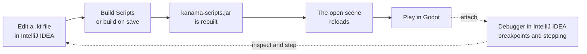

# Edit, Build, Run

You edit a script in IntelliJ IDEA, build it, and play it in Godot:



## The Kanama Tools Plugin

A Kanama project has two addons:

- `addons/kanama` is the runtime. Godot loads it, and your game needs it.
- `addons/kanama_tools` is the **Kanama Tools** editor plugin. It runs only in
  the editor, and a game runs without it.

The release kit and a starter project have the plugin enabled. Elsewhere,
enable it in **Project > Project Settings > Plugins**. It adds:

- a row in the editor toolbar: the build status light, **Build Scripts**,
  **Platforms** for the Android, iOS and Web builds, and **Open Kotlin**,
  which opens your Kotlin source folder in the file manager;
- **Build Scripts** and **Set Up Kanama Project** in **Project > Tools**. The
  second turns a Godot project with the store addon into a Kanama project; see
  [Add Kanama to an Existing Project](store-addon.md#installation).
- build on save and scene reload after a build, both described below;
- Kotlin syntax colors in Godot's script editor, for a quick look or a small
  edit. IntelliJ IDEA is where you get completion, navigation and the
  debugger; see [Open in IntelliJ IDEA](intellij.md).
- a Java check when the editor starts. It warns when Godot cannot find a
  JDK 25 or newer, and tells you which setting to change. See
  [JDK Selection](#jdk-selection).

## Building Scripts

Press **Build Scripts**, or run the same build in a terminal in the project
folder:

```sh
cd /path/to/your-project
./gradlew buildScripts
```

The build compiles every `.kt` file in `kotlin-src/` against the Kanama
libraries in `addons/kanama/maven`, and writes
`addons/kanama/kanama-scripts.jar`. Godot picks the new jar up by itself. You
can also run `buildScripts` from IntelliJ's Gradle tool window. The release
kit, the starter and the store addon all set up that task; a project with a
`gradlew` of its own needs it too.

You rarely need to press it: build on save is on. The plugin watches the
`.kt` files in the folder your build compiles, `kotlin-src/` (and
`web/kotlin-src/` when there is one; `kanamaProjectScriptsDir` in
`gradle.properties` names another folder), and builds once you stop saving
for a moment
(`kanama/tools/auto_build_debounce_ms`, 800 ms by default). Saving several
files in a row starts one build. To build only when you ask, turn off
**Editor > Editor Settings > Kanama > Build > Build On Save**
(`kanama/build/build_on_save`). It is an editor setting, so it applies to you
on this machine and is not stored in the project.

### The Status Light

The dot at the left of the Kanama toolbar row tells you whether the game will
run the code you see:

| Light | Meaning |
| --- | --- |
| Green | Your scripts are built, and no `.kt` file changed since. |
| Yellow | A build is running, a `.kt` file changed since the last build, `kanama-scripts.jar` is missing, or your scripts were built for another Kanama version than the addon. |
| Red | The last build failed, or ran longer than the build timeout and was stopped. |
| Grey | The project has no Kotlin scripts yet. |

Click the light to see the output of the last build, with the compiler's
error when it failed; when a build fails, the Output panel shows the same
text. While a build runs, the same window has **Cancel Build**. A build that
runs longer than **Editor > Editor Settings > Kanama > Build > Build Timeout
Sec** (`kanama/build/build_timeout_sec`, 1200 seconds by default) is stopped,
and the light turns red.

### Platform Builds

**Platforms** builds your scripts for another platform's export. In a project
made from a release kit or the store addon, it has **Android**, which runs
`./gradlew buildAndroidScripts`; see [Export for Android](../exporting/android.md).

In a project set up from a Kanama checkout, it runs the commands the export
pages give, in that checkout:

- **Android** runs `installAndroidPluginAar` and then `installAddonJar`; see
  [Export for Android](../exporting/android.md).
- **iOS**, on macOS, runs `installIosAddon`; see
  [Export for iOS](../exporting/ios.md).
- **Web** runs `:web-runtime:exportWeb`; see
  [Export for the Web](../exporting/web.md).

The status light follows these builds like any other. When your scripts were
built for another Kanama version than the addon, the light turns yellow and
its tooltip says which versions; **Build Scripts**, or **Sync Addon** in the
message Godot shows, rebuilds them.

### Projects without Their Own Gradle Build

A project set up from a checkout with `installStarterTemplate` has no
`gradlew` of its own. There, **Build Scripts** runs this from your Kanama
checkout:

```sh
./gradlew -p /path/to/kanama installAddonJar \
  -PkanamaProjectDir=/path/to/your-project \
  -PkanamaProjectScriptsDir=/path/to/your-project
```

That rebuilds the Kanama runtime and native loader too, and copies them into
`addons/kanama`. The plugin finds the checkout at `../kanama` or
`../../kanama` from the project, or where `kanama/tools/repo_dir` points.
[Adding Kanama to an Existing Project](source-checkout.md#adding-kanama-to-an-existing-project)
sets this up.

## Reloading after a Build

**In the editor**, a build switches every Kotlin script the editor has loaded
to the new code. Nodes already in the open scene keep their old code until the
scene reloads, so the plugin reloads the current scene after each build. The
setting for that is **Reload Scene After Sync**
(`kanama/tools/reload_scene_after_sync`; "sync" is the plugin's word for a
finished build), and it is on by default.

**In a running game**, Kanama checks for a new build every half second. Nodes
the game already has keep running their old code until their scene reloads.
New instances and Kotlin autoloads use the new code at once. To see a change
in the game, restarting it is the fastest path. From saving a file to the
change showing takes a few seconds either way.

This covers scripts you attach to nodes, the `@ScriptClass` classes. A class
you register with `@RegisterClass` becomes a Godot class, and Godot only
reads those at startup: restart the editor after changing one.

## Debugging

The plugin adds two project settings for the debugger:

```ini
[kanama]
debug/jdwp_enabled=true
debug/jdwp_port=5005
```

Turn them on, then create an IntelliJ **Remote JVM Debug** run configuration
for `localhost:5005`. Press **Play** in Godot and attach the debugger. You can
set breakpoints in your scripts and step through callbacks, signal handlers
and the rest of your game code while it runs.
[Open in IntelliJ IDEA](intellij.md#debug-the-running-game) walks through it,
including how to stop before `_ready` runs.

Restart the game after changing either setting: Kanama reads them when it
starts Java. When you press **Play**, the editor leaves the port free so the
game can take it. The port listens on `localhost` only. A second game instance
that finds the port taken starts without the debugger and says so.

For a single launch, the `KANAMA_JDWP_PORT=5005` environment variable
overrides the port setting. A full address, `KANAMA_JDWP_PORT='*:5005'`,
opens the port to other machines. Other Java options, such as a GC log or heap
sizes, go in `KANAMA_JVM_OPTIONS`, for example `KANAMA_JVM_OPTIONS="-Xlog:gc"`;
see [JVM Options](../exporting/desktop.md#jvm-options).

## JDK Selection

Kanama needs a JDK 25 or newer twice: **Build Scripts** builds with it, and the
game runs your scripts on it inside Godot. Both use the first of these that
works:

1. **Editor Settings > Kanama > Build > JDK Path** (`kanama/build/jdk_path`).
   Set it to the JDK folder, the one that contains `bin/` and `lib/`. It is
   stored per machine, not in the project.
2. `JAVA_HOME`, when it points at a JDK 25 or newer.
3. A JDK 25 or newer in the usual install folders.

To use a particular JDK, set JDK Path. After you change it, and the first time
you open a project while it is set, restart the editor once; the plugin
reminds you with **"Restart the editor to use JDK ..."**. The Output panel
names the JDK each build used.

??? note "Install folders Kanama searches"
    | OS | Searched |
    | --- | --- |
    | Linux | `/usr/lib/jvm`, `/usr/lib64/jvm`, `/usr/java`, `/usr/local/java`, `/opt/java`, `/opt/jdk` |
    | macOS | `/Library/Java/JavaVirtualMachines/*/Contents/Home`, `~/Library/Java/JavaVirtualMachines/*/Contents/Home`, Homebrew `openjdk*` under `/opt/homebrew/opt` and `/usr/local/opt` |
    | Windows | `%ProgramFiles%\{Java, Eclipse Adoptium, Microsoft, Zulu, BellSoft, Amazon Corretto, Semeru, Temurin}`, Scoop `~\scoop\apps\*\current` |
    | All | `~/.jdks` (IntelliJ), `~/.sdkman/candidates/java` |

    When several qualify, Kanama prefers a JDK 25 release. An exported game
    does not search at all: it uses the Java runtime it ships with.

## Settings

The plugin adds these to **Project > Project Settings** under **Kanama**
(switch on **Advanced Settings** to see them). In `project.godot` they sit
under `[kanama]`.

| Setting | What it does |
| --- | --- |
| `kanama/tools/auto_build_debounce_ms` | How long build on save waits after the last save. Default 800 ms. |
| `kanama/tools/reload_scene_after_sync` | Reloads the current scene after a successful build. On by default. |
| `kanama/tools/kotlin_sources_dir` | The folder **Open Kotlin** opens, absolute or `res://`. Empty opens the project folder. |
| `kanama/tools/repo_dir` | Your Kanama checkout, for a project without its own Gradle build. Empty looks in the parent folder, then `../kanama` and `../../kanama`. |
| `kanama/tools/java_preflight_enabled` | Warns in the editor when Godot cannot find a JDK 25 or newer. On by default. |
| `kanama/tools/export_guard_enabled` | Stops an export whose scenes use Kotlin scripts that do not load. On by default; see [Export Guard](#export-guard). |
| `kanama/tools/developer_mode` | Shows **Build Runtime**, which rebuilds the Kanama runtime from a checkout. For people working on Kanama itself; games use **Build Scripts**. |
| `kanama/debug/jdwp_enabled`, `kanama/debug/jdwp_port` | The debugger; see [Debugging](#debugging). |
| `kanama/jvm/options` | Extra Java options for the game; see [JVM Options](../exporting/desktop.md#jvm-options). |

Three Kanama settings are editor settings, under **Editor > Editor Settings >
Kanama > Build**, because they belong to your machine and not to the project:
**Build On Save** (`kanama/build/build_on_save`, on by default; see
[Building Scripts](#building-scripts)), **Build Timeout Sec**
(`kanama/build/build_timeout_sec`; see [The Status Light](#the-status-light))
and **JDK Path** (see [JDK Selection](#jdk-selection)).

## Export Guard

When an export begins, on any platform, the Kanama Tools plugin checks every
`.kt` script that the exported scenes and resources use. If one does not load
in the editor, for example because `kanama-scripts.jar` is out of date, it
stops the export with one error that starts with `Kanama: Export stopped:` and
names the scripts and the fix. Without the check, Godot would ship those
scenes without the scripts' property values, and say nothing.

- A command-line export ends before it writes any file, with a non-zero exit
  status.
- An export from the Export dialog shows the error and is marked failed. The
  files it writes are the ones Godot would have written without the check, so
  do not ship them.
- A one-click deploy installs nothing.

Only the scenes and resources the export preset exports are checked; a `.kt`
file that no scene uses is not. To fix the error, build your scripts again, as
the shipping page for your platform shows, and export again. Turn the check
off with `kanama/tools/export_guard_enabled` only to export knowingly without
those scripts.

An Android export stops the same way when the preset's **Min SDK** is below
`33` or empty, because Kanama needs Android 13 or newer. The Export dialog
also shows the warning on the Min SDK field. Set it to `33` under **Gradle
Build**.

## On Other Platforms

On **Windows**, run `.\gradlew.bat` wherever this page says `./gradlew`.

On **Linux and Windows**, Godot started from an application menu, a desktop
shortcut or a file manager does not see the `JAVA_HOME` from your shell
profile. If that `JAVA_HOME` is the only way Kanama could find your JDK, set
JDK Path instead.

Editors installed as a **Flatpak or Snap** run in a sandbox that cannot see
`/usr/lib/jvm` or your shell's `JAVA_HOME`. Grant the sandbox access to the JDK
folder (for Flatpak, `flatpak override --user --filesystem=<jdk dir>:ro`),
point JDK Path at a JDK inside a path the sandbox can read, or use the
unsandboxed Godot build. A build you run in a terminal is not affected: it
uses the shell's `JAVA_HOME`.
