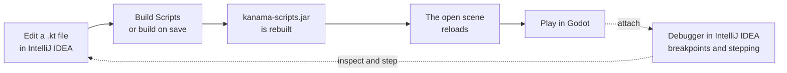

# Edit, Build, Run

You edit a script in IntelliJ IDEA, build it, and play it in Godot:



## The Kanama Tools Plugin

A Kanama project has two addons:

- `addons/kanama` is the runtime. Godot loads it, and your game needs it.
- `addons/kanama_tools` is the **Kanama Tools** editor plugin. It runs only in
  the editor, and a game runs without it.

The release kit and a starter project have the plugin enabled. Elsewhere,
enable it in **Project > Project Settings > Plugins**. It adds:

- **Build Scripts** to the editor toolbar and to **Project > Tools**;
- **Open Kotlin**, which opens your Kotlin source folder in the file manager;
- build on save and scene reload after a build, both described below;
- Kotlin syntax colors in Godot's script editor, for a quick look or a small
  edit. IntelliJ IDEA is where you get completion, navigation and the
  debugger; see [Open in IntelliJ IDEA](intellij.md).
- a Java check when the editor starts. It warns when Godot cannot find a
  JDK 25 or newer, and tells you which setting to change. See
  [JDK Selection](#jdk-selection).

## Building Scripts

Press **Build Scripts**, or run the same build in a terminal in the project
folder:

```sh
cd /path/to/your-project
./gradlew buildScripts
```

The build compiles every `.kt` file in `kotlin-src/` against the Kanama
libraries in `addons/kanama/maven`, and writes
`addons/kanama/kanama-scripts.jar`. Godot picks the new jar up by itself. You
can also run `buildScripts` from IntelliJ's Gradle tool window. The release
kit, the starter and the store addon all set up that task; a project with a
`gradlew` of its own needs it too.

To build without pressing anything, turn on `kanama/tools/auto_build_on_save`
in **Project > Project Settings** (switch on **Advanced Settings** to see it).
The plugin then watches your `.kt` files and builds once you stop saving for
`kanama/tools/auto_build_debounce_ms` (800 ms by default).

### Projects without Their Own Gradle Build

A project set up from a checkout with `installStarterTemplate` has no
`gradlew` of its own. There, **Build Scripts** runs this from your Kanama
checkout:

```sh
./gradlew -p /path/to/kanama installAddonJar \
  -PkanamaProjectDir=/path/to/your-project \
  -PkanamaProjectScriptsDir=/path/to/your-project
```

That rebuilds the Kanama runtime and native loader too, and copies them into
`addons/kanama`. The plugin finds the checkout at `../kanama` or
`../../kanama` from the project, or where `kanama/tools/repo_dir` points.
[Adding Kanama to an Existing Project](source-checkout.md#adding-kanama-to-an-existing-project)
sets this up.

## Reloading after a Build

**In the editor**, a build switches every Kotlin script the editor has loaded
to the new code. Nodes already in the open scene keep their old code until the
scene reloads, so the plugin reloads the current scene after each build. The
setting for that is **Reload Scene After Sync**
(`kanama/tools/reload_scene_after_sync`; "sync" is the plugin's word for a
finished build), and it is on by default.

**In a running game**, Kanama checks for a new build every half second. Nodes
the game already has keep running their old code until their scene reloads.
New instances and Kotlin autoloads use the new code at once. To see a change
in the game, restarting it is the fastest path. From saving a file to the
change showing takes a few seconds either way.

This covers scripts you attach to nodes, the `@ScriptClass` classes. A class
you register with `@RegisterClass` becomes a Godot class, and Godot only
reads those at startup: restart the editor after changing one.

## Debugging

The plugin adds two project settings for the debugger:

```ini
[kanama]
debug/jdwp_enabled=true
debug/jdwp_port=5005
```

Turn them on, then create an IntelliJ **Remote JVM Debug** run configuration
for `localhost:5005`. Press **Play** in Godot and attach the debugger. You can
set breakpoints in your scripts and step through callbacks, signal handlers
and the rest of your game code while it runs.
[Open in IntelliJ IDEA](intellij.md#debug-the-running-game) walks through it,
including how to stop before `_ready` runs.

Restart the game after changing either setting: Kanama reads them when it
starts Java. When you press **Play**, the editor leaves the port free so the
game can take it. The port listens on `localhost` only. A second game instance
that finds the port taken starts without the debugger and says so.

For a single launch, the `KANAMA_JDWP_PORT=5005` environment variable
overrides the port setting. A full address, `KANAMA_JDWP_PORT='*:5005'`,
opens the port to other machines. Other Java options, such as a GC log or heap
sizes, go in `KANAMA_JVM_OPTIONS`, for example `KANAMA_JVM_OPTIONS="-Xlog:gc"`;
see [JVM Options](../exporting/desktop.md#jvm-options).

## JDK Selection

Kanama needs a JDK 25 or newer twice: **Build Scripts** builds with it, and the
game runs your scripts on it inside Godot. Both use the first of these that
works:

1. **Editor Settings > Kanama > Build > JDK Path** (`kanama/build/jdk_path`).
   Set it to the JDK folder, the one that contains `bin/` and `lib/`. It is
   stored per machine, not in the project.
2. `JAVA_HOME`, when it points at a JDK 25 or newer.
3. A JDK 25 or newer in the usual install folders.

To use a particular JDK, set JDK Path. After you change it, and the first time
you open a project while it is set, restart the editor once; the plugin
reminds you with **"Restart the editor to use JDK ..."**. The Output panel
names the JDK each build used.

??? note "Install folders Kanama searches"
    | OS | Searched |
    | --- | --- |
    | Linux | `/usr/lib/jvm`, `/usr/lib64/jvm`, `/usr/java`, `/usr/local/java`, `/opt/java`, `/opt/jdk` |
    | macOS | `/Library/Java/JavaVirtualMachines/*/Contents/Home`, `~/Library/Java/JavaVirtualMachines/*/Contents/Home`, Homebrew `openjdk*` under `/opt/homebrew/opt` and `/usr/local/opt` |
    | Windows | `%ProgramFiles%\{Java, Eclipse Adoptium, Microsoft, Zulu, BellSoft, Amazon Corretto, Semeru, Temurin}`, Scoop `~\scoop\apps\*\current` |
    | All | `~/.jdks` (IntelliJ), `~/.sdkman/candidates/java` |

    When several qualify, Kanama prefers a JDK 25 release. An exported game
    does not search at all: it uses the Java runtime it ships with.

## Settings

The plugin adds these to **Project > Project Settings** under **Kanama**
(switch on **Advanced Settings** to see them). In `project.godot` they sit
under `[kanama]`.

| Setting | What it does |
| --- | --- |
| `kanama/tools/auto_build_on_save` | Builds your scripts when you save a `.kt` file. Off by default. |
| `kanama/tools/auto_build_debounce_ms` | How long build on save waits after the last save. Default 800 ms. |
| `kanama/tools/reload_scene_after_sync` | Reloads the current scene after a successful build. On by default. |
| `kanama/tools/kotlin_sources_dir` | The folder **Open Kotlin** opens, absolute or `res://`. Empty opens the project folder. |
| `kanama/tools/repo_dir` | Your Kanama checkout, for a project without its own Gradle build. Empty looks in the parent folder, then `../kanama` and `../../kanama`. |
| `kanama/tools/java_preflight_enabled` | Warns in the editor when Godot cannot find a JDK 25 or newer. On by default. |
| `kanama/tools/export_guard_enabled` | Stops an export whose scenes use Kotlin scripts that do not load. On by default; see below. |
| `kanama/tools/developer_mode` | Shows **Build Runtime**, which rebuilds the Kanama runtime from a checkout. For people working on Kanama itself; games use **Build Scripts**. |
| `kanama/debug/jdwp_enabled`, `kanama/debug/jdwp_port` | The debugger; see [Debugging](#debugging). |
| `kanama/jvm/options` | Extra Java options for the game; see [JVM Options](../exporting/desktop.md#jvm-options). |

JDK Path is an editor setting, not a project setting; see
[JDK Selection](#jdk-selection).

The **export guard** checks every `.kt` script the exported scenes use when an
export begins. If one does not load in the editor, for example because
`kanama-scripts.jar` is out of date, it reports
`Kanama: Export stopped: …` with the script names. Without the guard, Godot
would ship those scenes without the scripts' property values. A command-line
export then exits with an error. An export from the Export dialog is marked
failed, but its files are still written. Turn the guard off only to export
knowingly without those scripts. [Export Guard](../exporting/android.md#export-guard)
has the details.

## On Other Platforms

On **Windows**, run `.\gradlew.bat` wherever this page says `./gradlew`.

On **Linux and Windows**, Godot started from an application menu, a desktop
shortcut or a file manager does not see the `JAVA_HOME` from your shell
profile. If that `JAVA_HOME` is the only way Kanama could find your JDK, set
JDK Path instead.

Editors installed as a **Flatpak or Snap** run in a sandbox that cannot see
`/usr/lib/jvm` or your shell's `JAVA_HOME`. Grant the sandbox access to the JDK
folder (for Flatpak, `flatpak override --user --filesystem=<jdk dir>:ro`),
point JDK Path at a JDK inside a path the sandbox can read, or use the
unsandboxed Godot build. A build you run in a terminal is not affected: it
uses the shell's `JAVA_HOME`.
