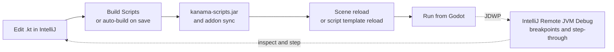

# Edit, Build, Run

You write Kotlin in IntelliJ IDEA, build it into a jar, and Godot runs it. GDScript
changes are live; a Kotlin change needs that build, which takes a few seconds.
This page covers each step of the loop, the settings that shorten it, and
attaching the debugger to a running game.



## The Kanama Tools Plugin

A Kanama project has two addons:

- `addons/kanama` is the runtime. Godot loads it, and your game needs it.
- `addons/kanama_tools` is the **Kanama Tools** editor plugin. It runs only in
  the editor, and a game runs without it.

The release kit and a starter project have the plugin enabled. Elsewhere,
enable it in **Project > Project Settings > Plugins**. It adds:

- **Build Scripts** to the editor toolbar and to **Project > Tools**;
- **Open Kotlin**, which opens your Kotlin source folder in the file manager;
- build on save and scene reload after a build, both described below;
- Kotlin syntax colors in Godot's script editor, for a quick look or a small
  edit. IntelliJ IDEA is where you get completion, navigation and the
  debugger; see [Open in IntelliJ IDEA](intellij.md).
- a Java check when the editor starts. It warns when Godot cannot find a
  JDK 25 or newer, and tells you which setting to change. See
  [Which JDK Kanama Uses](#which-jdk-kanama-uses).

## Building Scripts

Press **Build Scripts**, or run the same build in a terminal in the project
folder:

```sh
cd /path/to/project
./gradlew buildScripts
```

The build compiles every `.kt` file in `kotlin-src/` against the Kanama
libraries in `addons/kanama/maven`, and writes
`addons/kanama/kanama-scripts.jar`. Godot picks the new jar up by itself. You
can also run `buildScripts` from IntelliJ's Gradle tool window. The release
kit, the starter and the store addon all set up that task; a project with a
`gradlew` of its own needs it too.

To build without pressing anything, turn on `kanama/tools/auto_build_on_save`
in **Project > Project Settings** (switch on **Advanced Settings** to see it).
The plugin then watches your `.kt` files and builds once you stop saving for
`kanama/tools/auto_build_debounce_ms` (800 ms by default).

### Projects Without Their Own Gradle Build

A project set up from a checkout with `installStarterTemplate` has no
`gradlew` of its own. There, **Build Scripts** runs this from your Kanama
checkout:

```sh
./gradlew -p <kanama checkout> installAddonJar \
  -PkanamaProjectDir=<current Godot project> \
  -PkanamaProjectScriptsDir=<current Godot project>
```

That rebuilds the Kanama runtime and native loader too, and copies them into
`addons/kanama`. The plugin finds the checkout at `../kanama` or
`../../kanama` from the project, or where `kanama/tools/repo_dir` points.
[Adding Kanama to an Existing Project](source-checkout.md#adding-kanama-to-an-existing-project)
sets this up.

## Reloading After a Build

After a build, the editor switches every Kotlin script it has loaded to the new
code. Nodes already in the open scene keep their old code until the scene
reloads, so the plugin reloads the current scene after each build. That is
`kanama/tools/reload_scene_after_sync`, on by default.

This covers scripts you attach to nodes, the `@ScriptClass` classes. A class
you register with `@RegisterClass` becomes a Godot class, and Godot only
reads those at startup: restart the editor after changing one.

A game that is already running loads the new build too; see
[How Long the Loop Takes](#how-long-the-loop-takes). Restarting the game is
usually faster.

## Debugging

The plugin adds two project settings for the Java debugger:

```ini
[kanama]
debug/jdwp_enabled=true
debug/jdwp_port=5005
```

Turn them on, then create an IntelliJ **Remote JVM Debug** run configuration
for `localhost:5005`. Press **Play** in Godot and attach the debugger. You can
set breakpoints in your scripts and step through callbacks, signal handlers
and the rest of your game code while it runs.
[Open in IntelliJ IDEA](intellij.md#debug-the-running-game) walks through it,
including how to stop before `_ready` runs.

Restart the game after changing either setting: Kanama reads them when it
starts Java. When you press **Play**, the editor leaves the port free so the
game can take it. The port listens on `localhost` only. A second game instance
that finds the port taken starts without the debugger and says so.

For a single launch, the `KANAMA_JDWP_PORT=5005` environment variable
overrides the project setting. A full address, `KANAMA_JDWP_PORT='*:5005'`,
opens the port to other machines. Other Java options, such as a GC log or heap
sizes, go in `KANAMA_JVM_OPTIONS`, for example `KANAMA_JVM_OPTIONS="-Xlog:gc"`;
see [JVM Options](../exporting/desktop.md#jvm-options).

## How Long the Loop Takes

Measured on a fresh starter: save `HelloScript.kt` with a changed print line,
then time until the change shows.

| From saving a `.kt` file until | Median | p90 |
| --- | --- | --- |
| `./gradlew buildScripts` has finished (build only) | 2.0 s | 2.1 s |
| a newly started game prints the new line (build, then Play again) | 2.4 s | 2.5 s |
| the editor shows it: build on save, then the scene reloads | 3.7 s | 3.8 s |
| a running game has loaded the new build | 2.6 s | 2.9 s |

Five runs each after one warm-up run, with the Gradle daemon running (the first
build after starting it took 4.3 s). Machine: Apple M1 Max, 64 GB, macOS 26.6,
Godot 4.7.2, JDK 25, headless editor and game; measured 2026-10-18.

About 1.5 s of the editor number is build on save waiting for you to stop
saving: it scans for changed files every 0.6 s and builds once
`kanama/tools/auto_build_debounce_ms` (800 ms) has passed without another
change. A running game checks for a new build every 0.5 s, but the nodes it
already has keep running their old code until their scene reloads; new
instances and Kotlin autoloads use the new code at once. For a change you want
to see in the game, restarting it is the fastest path.

The budget is a median of 5 s or less from save to the change showing in the
editor. To measure your own machine:

```sh
python3 scripts/measure_edit_loop.py /path/to/godot --runs 5
```

It creates a fresh starter from your checkout, runs the four measurements, and
prints the median, the p90 and a budget line. The budget line is a report: the
script fails only when it cannot take a measurement.

## Which JDK Kanama Uses

Kanama needs a JDK 25 or newer twice: **Build Scripts** builds with it, and the
game runs your scripts on it inside Godot. Both pick the first of these:

1. The **`kanama/build/jdk_path`** editor setting, in
   **Editor > Editor Settings > Kanama > Build**. Set it to the JDK folder, the
   one that contains `bin/` and `lib/`. It is stored per machine, not in the
   project.
2. `JAVA_HOME`, when it points at a JDK 25 or newer.
3. A JDK 25 or newer in the usual install folders.

The Output panel names the JDK each build used. After you change the setting,
restart the editor: the plugin reminds you with **"Restart the editor to use
JDK ..."**.

On Linux and Windows, Godot started from an application menu, a desktop
shortcut or a file manager does not see the `JAVA_HOME` from your shell
profile. If that `JAVA_HOME` is the only way Kanama could find your JDK, set
`kanama/build/jdk_path` instead.

Editors installed as a **Flatpak or Snap** run in a sandbox that cannot see
`/usr/lib/jvm` or your shell's `JAVA_HOME`. Grant the sandbox access to the JDK
folder (for Flatpak, `flatpak override --user --filesystem=<jdk dir>:ro`), point
`kanama/build/jdk_path` at a JDK inside a path the sandbox can read, or use the
unsandboxed Godot build. A build you run in a terminal (`./gradlew ...`) is not
affected: it uses the shell's `JAVA_HOME`.

??? note "Where Kanama looks, and which JDK wins"
    **Install folders.** A JDK counts when its `release` file says 25 or newer.
    Among those, a GA release beats an early-access one, exactly 25 beats a
    newer major version, and then the newer version wins.

    | OS | Searched |
    | --- | --- |
    | Linux | `/usr/lib/jvm`, `/usr/lib64/jvm`, `/usr/java`, `/usr/local/java`, `/opt/java`, `/opt/jdk` |
    | macOS | `/Library/Java/JavaVirtualMachines/*/Contents/Home`, `~/Library/Java/JavaVirtualMachines/*/Contents/Home`, Homebrew `openjdk*` under `/opt/homebrew/opt` and `/usr/local/opt` |
    | Windows | `%ProgramFiles%\{Java, Eclipse Adoptium, Microsoft, Zulu, BellSoft, Amazon Corretto, Semeru, Temurin}`, Scoop `~\scoop\apps\*\current` |
    | All | `~/.jdks` (IntelliJ), `~/.sdkman/candidates/java` |

    **The editor setting.** It must be an absolute path; `~/` is expanded. A
    wrong value is an error, never silently replaced by another JDK. A
    `JAVA_HOME` older than 25 is skipped, not an error.

    **Build Scripts** needs a full JDK, with `include/jni.h`: a JRE cannot
    compile the native loader. If no JDK qualifies, the build stops before it
    starts, with an error that names `kanama/build/jdk_path` and `JAVA_HOME`.
    The native loader's CMake step also checks that the JDK's `jni.h` is from
    JDK 21 or newer, and names the JDK when it is not.

    **The runtime** cannot read editor settings when Godot loads it. The plugin
    therefore writes a valid `kanama/build/jdk_path` to `.godot/kanama_jdk_home`
    in the project, and removes the file when the setting is empty or invalid.
    The runtime reads that file first. If the JDK it names has been removed or
    is older than 25, the runtime logs `[kanama] ignoring
    .godot/kanama_jdk_home=...` with the reason and goes on with `JAVA_HOME`
    and the install folders. The runtime reads the file once, when Godot loads
    Kanama, which is before the plugin can write it. That is why the first open
    of a project, such as a fresh clone or a deleted `.godot` folder, and any
    change to the setting, ask for an editor restart.

    **Gradle** runs on any JDK 25 or newer. The build pins JDK 25; if only
    another JDK is installed, such as JDK 26 alone, Gradle downloads a JDK 25
    once into `~/.gradle/jdks` and reuses it. That needs network access the
    first time; install a JDK 25 to avoid the download.

    **An exported game** with a bundled runtime ignores all of this and uses
    its own `runtime/` folder.

## Settings

The plugin adds these to **Project > Project Settings** under **Kanama**
(switch on **Advanced Settings** to see them). In `project.godot` they sit
under `[kanama]`.

| Setting | What it does |
| --- | --- |
| `kanama/tools/auto_build_on_save` | Builds your scripts when you save a `.kt` file. Off by default. |
| `kanama/tools/auto_build_debounce_ms` | How long build on save waits after the last save. Default 800 ms. |
| `kanama/tools/reload_scene_after_sync` | Reloads the current scene after a successful build. On by default. |
| `kanama/tools/kotlin_sources_dir` | The folder **Open Kotlin** opens, absolute or `res://`. Empty opens the project folder. |
| `kanama/tools/repo_dir` | Your Kanama checkout, for a project without its own Gradle build. Empty looks in the parent folder, then `../kanama` and `../../kanama`. |
| `kanama/tools/java_preflight_enabled` | Warns in the editor when Godot cannot find a JDK 25 or newer. On by default. |
| `kanama/tools/export_guard_enabled` | On by default. Stops an export when an exported scene uses a `.kt` script that does not load in the editor, for example because `kanama-scripts.jar` is out of date. Without it, Godot would ship those scenes without the script's property values. A command-line export exits with an error; an export from the Export dialog is marked failed, but its files are written. See [Export Guard](../exporting/android.md#export-guard). Turn it off only to export knowingly without those scripts. |
| `kanama/tools/developer_mode` | Shows **Build Runtime**, which rebuilds the Kanama runtime from a checkout. For people working on Kanama itself; games use **Build Scripts**. |
| `kanama/debug/jdwp_enabled`, `kanama/debug/jdwp_port` | The Java debugger; see [Debugging](#debugging). |
| `kanama/jvm/options` | Extra Java options for the game; see [JVM Options](../exporting/desktop.md#jvm-options). |

`kanama/build/jdk_path` is an editor setting, not a project setting; see
[Which JDK Kanama Uses](#which-jdk-kanama-uses).
